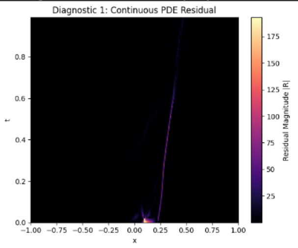
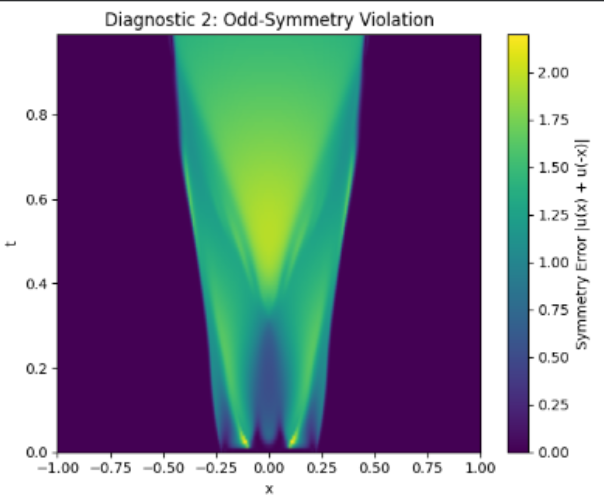
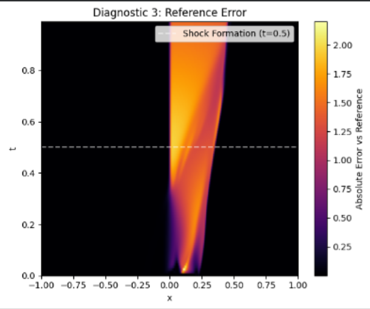

# B1.2 — Vanilla Burgers PINN Diagnostic Evaluation

## Objective
Evaluate the trained Adam + L-BFGS PINN without further training to investigate its PDE residual, odd-symmetry violations, and reference-solution error.

The model was evaluated on a dense grid containing 256 spatial points and 100 time points, giving 25,600 space-time evaluation points.

## 1. PDE Residual
The Burgers equation residual was calculated using automatic differentiation:

$$
R_\theta = u_t + u_\theta u_x - \nu u_{xx}, \qquad \nu = \frac{0.01}{\pi}
$$

Reported results:
* Maximum absolute residual: $1.9292 \times 10^2$
* Mean absolute residual: $4.6913 \times 10^1$

The residual plot shows large values around the region where the predicted sharp front is displaced.

**Finding:** The reported dense-grid residual is unexpectedly large compared with the small PDE training loss after L-BFGS. The calculation must be verified before these values can be interpreted as reliable evidence of PDE violations.

## 2. Odd-Symmetry Violation
The expected symmetry of the benchmark solution is:

$$
u(-x,t) = -u(x,t)
$$

The diagnostic calculates the absolute sum of predictions at mirrored spatial positions:

$$
E_{\mathrm{sym}}(x,t) = \left|u_\theta(x,t) + u_\theta(-x,t)\right|
$$

Reported results:
* Maximum symmetry error: $2.1973$
* Mean symmetry error: $0.4839$

**Finding:** The predicted solution exhibits substantial odd-symmetry violations, particularly around the developing steep-gradient region. This supports the observation that the learned solution is inaccurate, but does not establish the cause of the error.

## 3. Reference-Solution Error
The absolute error was calculated by comparing the PINN prediction with the Burgers.npz reference solution at matching space-time coordinates.

The error field shows that the largest discrepancies occur around the steep front as time increases. At $t=0.99$, the predicted transition remains displaced to the right of the reference transition near $x=0$.

**Finding:** The misplaced front is a major visible source of solution error.

## Preliminary Conclusions
1. The PINN does not accurately reproduce the steep front of the Burgers reference solution.
2. The predicted solution violates the expected odd symmetry.
3. The reported dense-grid PDE residual requires verification because of its large discrepancy from the training residual.
4. These results do not yet establish whether the underlying cause is collocation-point placement, optimization, constraint enforcement, numerical precision, or an implementation issue.

## Next Step: B1.2A — Diagnostic Verification
The next experiment will verify the loaded checkpoint, test automatic differentiation against analytical derivatives, recalculate the PDE residual in batches, and compute a normalized symmetry-error metric.

Adaptive-sampling experiments will be considered after the diagnostic calculations have been verified.

**Status:** Diagnostic evaluation completed; verification pending.

## Results

