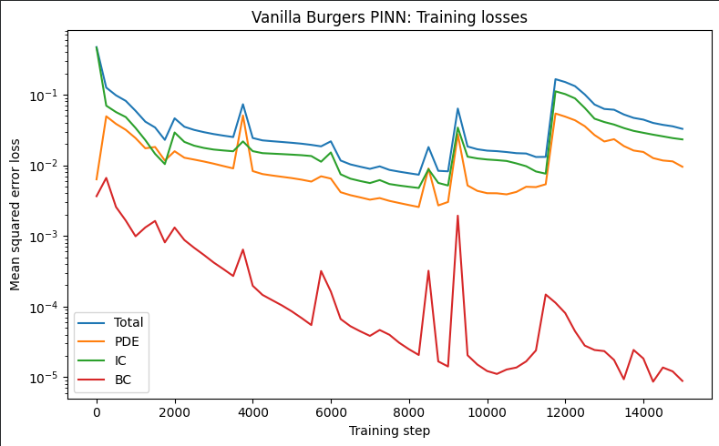
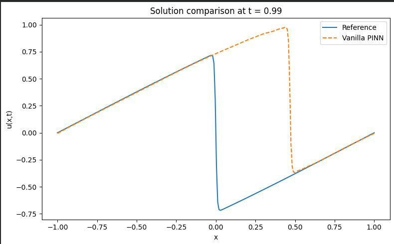
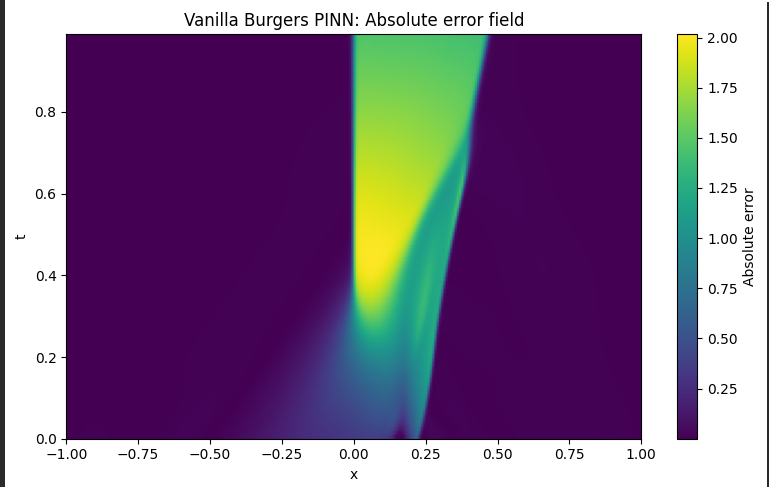

# Phase B1 — Vanilla Burgers PINN: Uniform-Random Sampling Baselines

## Overview
This phase evaluates a vanilla Physics-Informed Neural Network (PINN) on the one-dimensional viscous Burgers equation:

$$
u_t+u u_x-\nu u_{xx}=0,\qquad \nu=\frac{0.01}{\pi}
$$

The domain is $x\in[-1,1]$, $t\in[0,1]$, with initial condition $u(x,0)=-\sin(\pi x)$ and zero boundary values at $x=-1$ and $x=1$.

The network contains four hidden layers with 64 neurons per layer and Tanh activations. The initial implementation uses 2,000 fixed, uniformly random PDE collocation points and soft initial- and boundary-condition losses. The reference solution is evaluated separately using the Burgers.npz dataset distributed with the Wu et al. sampling repository.

The objective is to establish a baseline, document its failure modes, and identify the next experiment needed before comparing adaptive sampling methods.

## 1. Baseline trial: 5,000 Adam steps
Configuration: Adam optimizer, learning rate $10^{-3}$, 5,000 optimization steps.

Reported results:
* Relative $L_2$ error: approximately 0.565 (56.49%).
* Relative $L_\infty$ error: approximately 1.970.
* Maximum absolute error: approximately 1.970.

Observations: The PINN reproduces much of the broad solution profile away from the sharp internal layer. However, the transition is misplaced, appearing around $x\approx0.15$ at $t=0.99$, rather than near the reference transition at $x=0$.

Interpretation: The baseline fails to capture the steep front accurately. Insufficient representation of this difficult region by the training points is one possible explanation, but the experiment does not establish that sampling alone caused the error.

## Results
Working directory: /content
Device: cpu
Viscosity nu = 0.0031830989

Starting B1: Vanilla Burgers PINN

Starting vanilla Burgers PINN training...
Step     1 | Total 4.7130e-01 | PDE 6.3170e-03 | IC 4.6133e-01 | BC 3.6473e-03
Step   250 | Total 1.2572e-01 | PDE 4.9341e-02 | IC 6.9752e-02 | BC 6.6273e-03
Step   500 | Total 9.7719e-02 | PDE 3.8559e-02 | IC 5.6594e-02 | BC 2.5666e-03
Step   750 | Total 8.1511e-02 | PDE 3.1741e-02 | IC 4.8124e-02 | BC 1.6464e-03
Step  1000 | Total 5.8985e-02 | PDE 2.4244e-02 | IC 3.3753e-02 | BC 9.8728e-04
Step  1250 | Total 4.1443e-02 | PDE 1.7394e-02 | IC 2.2731e-02 | BC 1.3180e-03
Step  1500 | Total 3.4290e-02 | PDE 1.8149e-02 | IC 1.4513e-02 | BC 1.6284e-03
Step  1750 | Total 2.2889e-02 | PDE 1.1685e-02 | IC 1.0394e-02 | BC 8.0931e-04
Step  2000 | Total 4.6222e-02 | PDE 1.5793e-02 | IC 2.9115e-02 | BC 1.3136e-03
Step  2250 | Total 3.5084e-02 | PDE 1.2793e-02 | IC 2.1416e-02 | BC 8.7411e-04
Step  2500 | Total 3.1667e-02 | PDE 1.2043e-02 | IC 1.8946e-02 | BC 6.7891e-04
Step  2750 | Total 2.9426e-02 | PDE 1.1303e-02 | IC 1.7585e-02 | BC 5.3762e-04
Step  3000 | Total 2.7648e-02 | PDE 1.0533e-02 | IC 1.6694e-02 | BC 4.2004e-04
Step  3250 | Total 2.6278e-02 | PDE 9.7403e-03 | IC 1.6199e-02 | BC 3.3852e-04
Step  3500 | Total 2.5084e-02 | PDE 9.0303e-03 | IC 1.5783e-02 | BC 2.7055e-04
Step  3750 | Total 7.3106e-02 | PDE 5.0694e-02 | IC 2.1772e-02 | BC 6.4050e-04
Step  4000 | Total 2.4313e-02 | PDE 8.2718e-03 | IC 1.5844e-02 | BC 1.9690e-04
Step  4250 | Total 2.2501e-02 | PDE 7.5072e-03 | IC 1.4847e-02 | BC 1.4620e-04
Step  4500 | Total 2.1898e-02 | PDE 7.1629e-03 | IC 1.4612e-02 | BC 1.2288e-04
Step  4750 | Total 2.1356e-02 | PDE 6.8643e-03 | IC 1.4388e-02 | BC 1.0353e-04
Step  5000 | Total 2.0809e-02 | PDE 6.5806e-03 | IC 1.4143e-02 | BC 8.5435e-05
Step  5250 | Total 2.0207e-02 | PDE 6.2537e-03 | IC 1.3884e-02 | BC 6.8787e-05
Step  5500 | Total 1.9436e-02 | PDE 5.8743e-03 | IC 1.3507e-02 | BC 5.4693e-05
Step  5750 | Total 1.8527e-02 | PDE 6.9828e-03 | IC 1.1226e-02 | BC 3.1837e-04
Step  6000 | Total 2.1826e-02 | PDE 6.4790e-03 | IC 1.5185e-02 | BC 1.6279e-04
Step  6250 | Total 1.1671e-02 | PDE 4.1547e-03 | IC 7.4500e-03 | BC 6.6568e-05
Step  6500 | Total 1.0289e-02 | PDE 3.7736e-03 | IC 6.4631e-03 | BC 5.2688e-05
Step  6750 | Total 9.5423e-03 | PDE 3.5124e-03 | IC 5.9852e-03 | BC 4.4667e-05
Step  7000 | Total 8.8940e-03 | PDE 3.2567e-03 | IC 5.5989e-03 | BC 3.8435e-05
Step  7250 | Total 9.6481e-03 | PDE 3.4322e-03 | IC 6.1694e-03 | BC 4.6541e-05
Step  7500 | Total 8.5950e-03 | PDE 3.1304e-03 | IC 5.4247e-03 | BC 3.9832e-05
Step  7750 | Total 8.1190e-03 | PDE 2.9224e-03 | IC 5.1659e-03 | BC 3.0702e-05
Step  8000 | Total 7.7155e-03 | PDE 2.7332e-03 | IC 4.9575e-03 | BC 2.4853e-05
Step  8250 | Total 7.3511e-03 | PDE 2.5628e-03 | IC 4.7677e-03 | BC 2.0613e-05
Step  8500 | Total 1.8115e-02 | PDE 9.0046e-03 | IC 8.7898e-03 | BC 3.2092e-04
Step  8750 | Total 8.3419e-03 | PDE 2.7020e-03 | IC 5.6233e-03 | BC 1.6711e-05
Step  9000 | Total 8.2052e-03 | PDE 3.0218e-03 | IC 5.1692e-03 | BC 1.4163e-05
Step  9250 | Total 6.3535e-02 | PDE 2.7461e-02 | IC 3.4139e-02 | BC 1.9348e-03
Step  9500 | Total 1.8424e-02 | PDE 5.1718e-03 | IC 1.3232e-02 | BC 2.0429e-05
Step  9750 | Total 1.6855e-02 | PDE 4.3410e-03 | IC 1.2499e-02 | BC 1.5099e-05
Step 10000 | Total 1.6109e-02 | PDE 4.0247e-03 | IC 1.2072e-02 | BC 1.2217e-05
Step 10250 | Total 1.5842e-02 | PDE 4.0127e-03 | IC 1.1818e-02 | BC 1.1115e-05
Step 10500 | Total 1.5387e-02 | PDE 3.8733e-03 | IC 1.1501e-02 | BC 1.2834e-05
Step 10750 | Total 1.4834e-02 | PDE 4.1938e-03 | IC 1.0626e-02 | BC 1.3693e-05
Step 11000 | Total 1.4673e-02 | PDE 4.9621e-03 | IC 9.6939e-03 | BC 1.6724e-05
Step 11250 | Total 1.3096e-02 | PDE 4.9051e-03 | IC 8.1668e-03 | BC 2.3913e-05
Step 11500 | Total 1.3135e-02 | PDE 5.3803e-03 | IC 7.6069e-03 | BC 1.4801e-04
Step 11750 | Total 1.6557e-01 | PDE 5.4039e-02 | IC 1.1142e-01 | BC 1.1319e-04
Step 12000 | Total 1.5063e-01 | PDE 4.8822e-02 | IC 1.0172e-01 | BC 8.0841e-05
Step 12250 | Total 1.3190e-01 | PDE 4.3354e-02 | IC 8.8498e-02 | BC 4.4786e-05
Step 12500 | Total 1.0062e-01 | PDE 3.5751e-02 | IC 6.4838e-02 | BC 2.7990e-05
Step 12750 | Total 7.2452e-02 | PDE 2.6785e-02 | IC 4.5642e-02 | BC 2.4248e-05
Step 13000 | Total 6.2685e-02 | PDE 2.1707e-02 | IC 4.0955e-02 | BC 2.3394e-05
Step 13250 | Total 6.1108e-02 | PDE 2.3391e-02 | IC 3.7700e-02 | BC 1.7518e-05
Step 13500 | Total 5.2372e-02 | PDE 1.8715e-02 | IC 3.3647e-02 | BC 9.3449e-06
Step 13750 | Total 4.6877e-02 | PDE 1.6175e-02 | IC 3.0678e-02 | BC 2.4299e-05
Step 14000 | Total 4.4273e-02 | PDE 1.5432e-02 | IC 2.8823e-02 | BC 1.8380e-05
Step 14250 | Total 3.9758e-02 | PDE 1.2636e-02 | IC 2.7114e-02 | BC 8.6313e-06
Step 14500 | Total 3.7351e-02 | PDE 1.1680e-02 | IC 2.5657e-02 | BC 1.3708e-05
Step 14750 | Total 3.5605e-02 | PDE 1.1353e-02 | IC 2.4240e-02 | BC 1.2083e-05
Step 15000 | Total 3.2769e-02 | PDE 9.5258e-03 | IC 2.3234e-02 | BC 8.8490e-06

Training time: 531.18 seconds
Model saved: /content/results/burgers_vanilla_model.pt
History saved: /content/results/training_history.csv
Loss plot saved: /content/results/training_losses.png
Reference file: /content/reference_data/Burgers.npz
Spatial points: 256
Time points: 100
Reference array shape: (256, 100)

===== REFERENCE EVALUATION =====
Dataset: /content/reference_data/Burgers.npz
Spatial points: 256
Time points: 100 (from 0.0000 to 0.9900)
Relative L2 error:      1.000002e+00
Relative Linf error:    2.016153e+00
Maximum absolute error: 2.016115e+00

Evaluation data saved: /content/results/reference_evaluation.npz
Comparison plot saved: /content/results/reference_comparison_final_time.png
Error plot saved: /content/results/absolute_error_field.png

B1 run finished.

