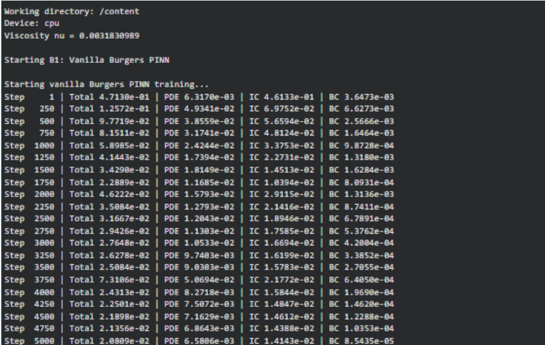
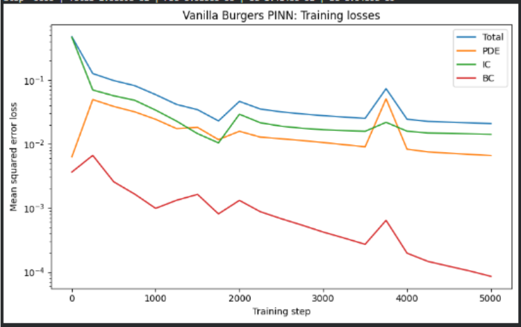
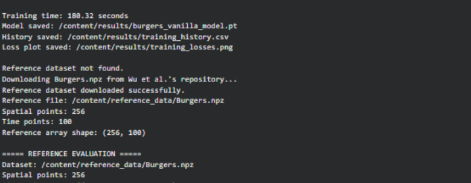
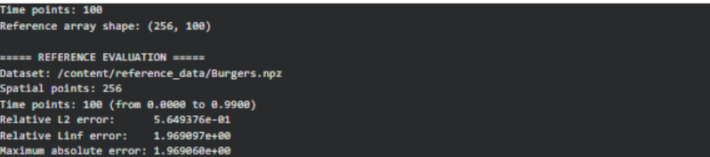
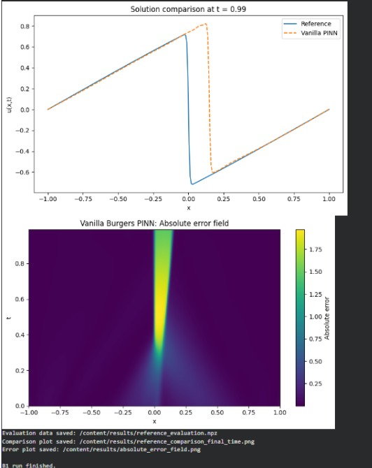

# Phase B1 — Vanilla Burgers PINN: Uniform-Random Sampling Baselines

## Overview
This phase evaluates a vanilla Physics-Informed Neural Network (PINN) on the one-dimensional viscous Burgers equation:

$$
u_t+u u_x-\nu u_{xx}=0,\qquad \nu=\frac{0.01}{\pi}
$$

The domain is $x\in[-1,1]$, $t\in[0,1]$, with initial condition $u(x,0)=-\sin(\pi x)$ and zero boundary values at $x=-1$ and $x=1$.

The network contains four hidden layers with 64 neurons per layer and Tanh activations. The initial implementation uses 2,000 fixed, uniformly random PDE collocation points and soft initial- and boundary-condition losses. The reference solution is evaluated separately using the Burgers.npz dataset distributed with the Wu et al. sampling repository.

The objective is to establish a baseline, document its failure modes, and identify the next experiment needed before comparing adaptive sampling methods.

## 1. Baseline trial: 5,000 Adam steps
Configuration: Adam optimizer, learning rate $10^{-3}$, 5,000 optimization steps.

Reported results:
* Relative $L_2$ error: approximately 0.565 (56.49%).
* Relative $L_\infty$ error: approximately 1.970.
* Maximum absolute error: approximately 1.970.

Observations: The PINN reproduces much of the broad solution profile away from the sharp internal layer. However, the transition is misplaced, appearing around $x\approx0.15$ at $t=0.99$, rather than near the reference transition at $x=0$.

Interpretation: The baseline fails to capture the steep front accurately. Insufficient representation of this difficult region by the training points is one possible explanation, but the experiment does not establish that sampling alone caused the error.

## Results

