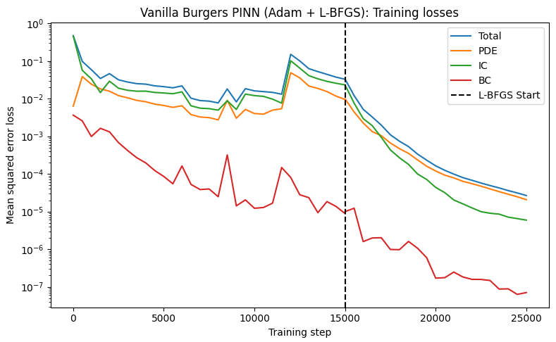
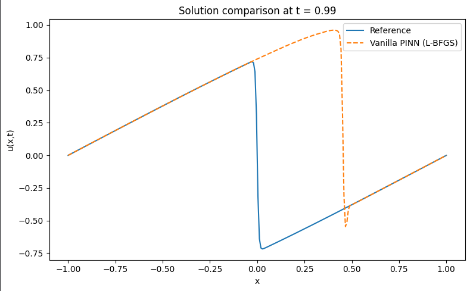
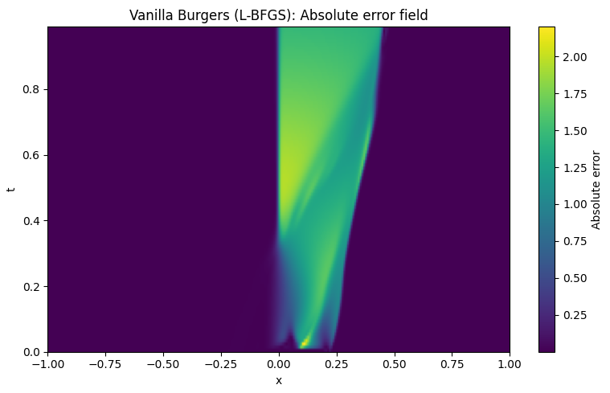

## 3. Combined optimization trial: 15,000 Adam steps followed by L-BFGS
Configuration: The 15,000-step Adam run was followed by PyTorch L-BFGS refinement. The optimizer stopped before completing its configured maximum number of iterations.

Reported results:
* Relative $L_2$ error: approximately 0.964.
* Relative $L_\infty$ error: approximately 2.201.
* Maximum absolute error: approximately 2.201.

Observations: L-BFGS substantially reduced the training losses, but relative $L_2$ error improved only slightly compared with the 15,000-step Adam result. Relative $L_\infty$ became worse. At $t=0.99$, the sharp transition remained misplaced, around $x\approx0.45$.

Interpretation: A lower training loss did not translate into a comparably accurate reference solution. This demonstrates that sampled training losses alone are insufficient to assess PINN solution accuracy. The relationship between sampled residuals, residuals between training points, symmetry and reference error requires further investigation.

## 4. Preliminary conclusions
1. The current vanilla PINN configuration has not recovered the Burgers reference solution accurately.
2. Increasing the number of Adam steps did not improve the result in the tested runs.
3. Adding L-BFGS reduced training losses but did not resolve the misplaced sharp front.
4. The large reference error motivates further investigation of the PDE residual, odd symmetry and constraint enforcement.
5. The current results do not prove that uniform-random sampling alone is responsible for the failure.

## 5. Next experiment
The next step is a diagnostic verification of the saved Adam–L-BFGS model. We will check automatic derivatives, evaluate PDE residuals on a dense diagnostic grid, quantify odd-symmetry violation and verify checkpoint consistency.

Once the diagnostic results are trustworthy, we will decide whether to align the baseline more closely with Wu et al.'s implementation or proceed to controlled adaptive-sampling experiments such as RAR-G, RAD or RAR-D.

**Status:** Preliminary baseline results recorded; diagnostic verification pending.

## Results
 Working directory: /content
Device: cpu
Viscosity nu = 0.0031830989

Starting B1: Vanilla Burgers PINN (Adam + L-BFGS)

Starting Phase 1: Adam Optimization (15000 steps)...
Adam Step     1 | Total 4.7130e-01 | PDE 6.3170e-03 | IC 4.6133e-01 | BC 3.6473e-03
Adam Step   500 | Total 9.7719e-02 | PDE 3.8559e-02 | IC 5.6594e-02 | BC 2.5666e-03
Adam Step  1000 | Total 5.8985e-02 | PDE 2.4244e-02 | IC 3.3753e-02 | BC 9.8728e-04
Adam Step  1500 | Total 3.4290e-02 | PDE 1.8149e-02 | IC 1.4513e-02 | BC 1.6284e-03
Adam Step  2000 | Total 4.6222e-02 | PDE 1.5793e-02 | IC 2.9115e-02 | BC 1.3136e-03
Adam Step  2500 | Total 3.1667e-02 | PDE 1.2043e-02 | IC 1.8946e-02 | BC 6.7891e-04
Adam Step  3000 | Total 2.7648e-02 | PDE 1.0533e-02 | IC 1.6694e-02 | BC 4.2004e-04
Adam Step  3500 | Total 2.5084e-02 | PDE 9.0303e-03 | IC 1.5783e-02 | BC 2.7055e-04
Adam Step  4000 | Total 2.4313e-02 | PDE 8.2718e-03 | IC 1.5844e-02 | BC 1.9690e-04
Adam Step  4500 | Total 2.1898e-02 | PDE 7.1629e-03 | IC 1.4612e-02 | BC 1.2288e-04
Adam Step  5000 | Total 2.0809e-02 | PDE 6.5806e-03 | IC 1.4143e-02 | BC 8.5435e-05
Adam Step  5500 | Total 1.9436e-02 | PDE 5.8743e-03 | IC 1.3507e-02 | BC 5.4693e-05
Adam Step  6000 | Total 2.1826e-02 | PDE 6.4790e-03 | IC 1.5185e-02 | BC 1.6279e-04
Adam Step  6500 | Total 1.0289e-02 | PDE 3.7736e-03 | IC 6.4631e-03 | BC 5.2688e-05
Adam Step  7000 | Total 8.8940e-03 | PDE 3.2567e-03 | IC 5.5989e-03 | BC 3.8435e-05
Adam Step  7500 | Total 8.5950e-03 | PDE 3.1304e-03 | IC 5.4247e-03 | BC 3.9832e-05
Adam Step  8000 | Total 7.7155e-03 | PDE 2.7332e-03 | IC 4.9575e-03 | BC 2.4853e-05
Adam Step  8500 | Total 1.8115e-02 | PDE 9.0046e-03 | IC 8.7898e-03 | BC 3.2092e-04
Adam Step  9000 | Total 8.2052e-03 | PDE 3.0218e-03 | IC 5.1692e-03 | BC 1.4163e-05
Adam Step  9500 | Total 1.8424e-02 | PDE 5.1718e-03 | IC 1.3232e-02 | BC 2.0429e-05
Adam Step 10000 | Total 1.6109e-02 | PDE 4.0247e-03 | IC 1.2072e-02 | BC 1.2217e-05
Adam Step 10500 | Total 1.5387e-02 | PDE 3.8733e-03 | IC 1.1501e-02 | BC 1.2834e-05
Adam Step 11000 | Total 1.4673e-02 | PDE 4.9621e-03 | IC 9.6939e-03 | BC 1.6724e-05
Adam Step 11500 | Total 1.3135e-02 | PDE 5.3803e-03 | IC 7.6069e-03 | BC 1.4801e-04
Adam Step 12000 | Total 1.5063e-01 | PDE 4.8822e-02 | IC 1.0172e-01 | BC 8.0841e-05
Adam Step 12500 | Total 1.0062e-01 | PDE 3.5751e-02 | IC 6.4838e-02 | BC 2.7990e-05
Adam Step 13000 | Total 6.2685e-02 | PDE 2.1707e-02 | IC 4.0955e-02 | BC 2.3394e-05
Adam Step 13500 | Total 5.2372e-02 | PDE 1.8715e-02 | IC 3.3647e-02 | BC 9.3449e-06
Adam Step 14000 | Total 4.4273e-02 | PDE 1.5432e-02 | IC 2.8823e-02 | BC 1.8380e-05
Adam Step 14500 | Total 3.7351e-02 | PDE 1.1680e-02 | IC 2.5657e-02 | BC 1.3708e-05
Adam Step 15000 | Total 3.2769e-02 | PDE 9.5258e-03 | IC 2.3234e-02 | BC 8.8490e-06

Starting Phase 2: L-BFGS Optimization (15000 max steps)...
L-BFGS Step 15001 | Total 3.2963e-02 | PDE 9.8658e-03 | IC 2.3087e-02 | BC 9.9519e-06
L-BFGS Step 15500 | Total 1.2039e-02 | PDE 4.4311e-03 | IC 7.5952e-03 | BC 1.2264e-05
L-BFGS Step 16000 | Total 5.2148e-03 | PDE 2.2620e-03 | IC 2.9512e-03 | BC 1.5907e-06
L-BFGS Step 16500 | Total 3.2533e-03 | PDE 1.3327e-03 | IC 1.9186e-03 | BC 1.9892e-06
L-BFGS Step 17000 | Total 1.9775e-03 | PDE 1.0382e-03 | IC 9.3728e-04 | BC 2.0166e-06
L-BFGS Step 17500 | Total 1.0972e-03 | PDE 6.6199e-04 | IC 4.3420e-04 | BC 9.8190e-07
L-BFGS Step 18000 | Total 7.4055e-04 | PDE 4.7020e-04 | IC 2.6937e-04 | BC 9.7108e-07
L-BFGS Step 18500 | Total 5.3266e-04 | PDE 3.5134e-04 | IC 1.7972e-04 | BC 1.6078e-06
L-BFGS Step 19000 | Total 3.3640e-04 | PDE 2.3575e-04 | IC 9.9592e-05 | BC 1.0596e-06
L-BFGS Step 19500 | Total 2.3239e-04 | PDE 1.6035e-04 | IC 7.1443e-05 | BC 5.9795e-07
L-BFGS Step 20000 | Total 1.6388e-04 | PDE 1.1986e-04 | IC 4.3853e-05 | BC 1.7023e-07
L-BFGS Step 20500 | Total 1.2487e-04 | PDE 9.2870e-05 | IC 3.1823e-05 | BC 1.7498e-07
L-BFGS Step 21000 | Total 9.8923e-05 | PDE 7.8381e-05 | IC 2.0294e-05 | BC 2.4692e-07
L-BFGS Step 21500 | Total 7.9768e-05 | PDE 6.3585e-05 | IC 1.6001e-05 | BC 1.8254e-07
L-BFGS Step 22000 | Total 6.7807e-05 | PDE 5.5119e-05 | IC 1.2530e-05 | BC 1.5808e-07
L-BFGS Step 22500 | Total 5.7339e-05 | PDE 4.7249e-05 | IC 9.9327e-06 | BC 1.5710e-07
L-BFGS Step 23000 | Total 4.9127e-05 | PDE 3.9963e-05 | IC 9.0169e-06 | BC 1.4734e-07
L-BFGS Step 23500 | Total 4.2486e-05 | PDE 3.3849e-05 | IC 8.5502e-06 | BC 8.7262e-08
L-BFGS Step 24000 | Total 3.6077e-05 | PDE 2.8875e-05 | IC 7.1139e-06 | BC 8.8421e-08
L-BFGS Step 24500 | Total 3.1264e-05 | PDE 2.4702e-05 | IC 6.4994e-06 | BC 6.2943e-08
L-BFGS Step 25000 | Total 2.6654e-05 | PDE 2.0669e-05 | IC 5.9143e-06 | BC 7.0350e-08

Training time: 1028.80 seconds

===== REFERENCE EVALUATION =====
Relative L2 error:      9.641196e-01
Relative Linf error:    2.200793e+00
Maximum absolute error: 2.200751e+00

B1 (L-BFGS) run finished.

