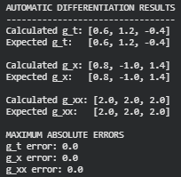
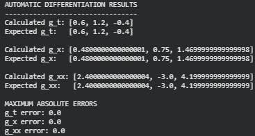
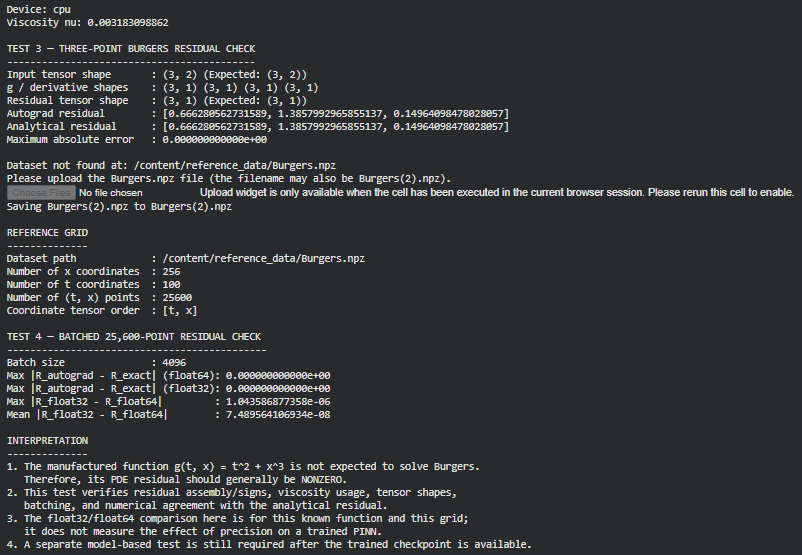
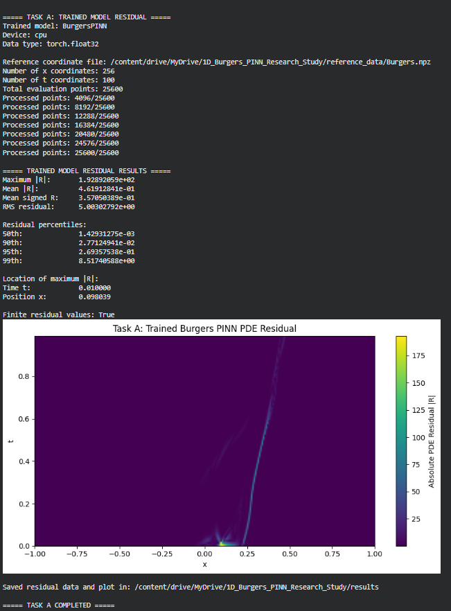
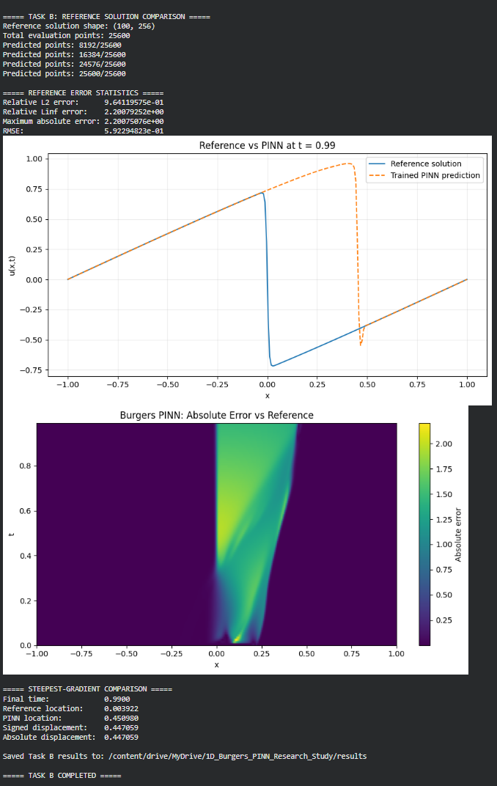
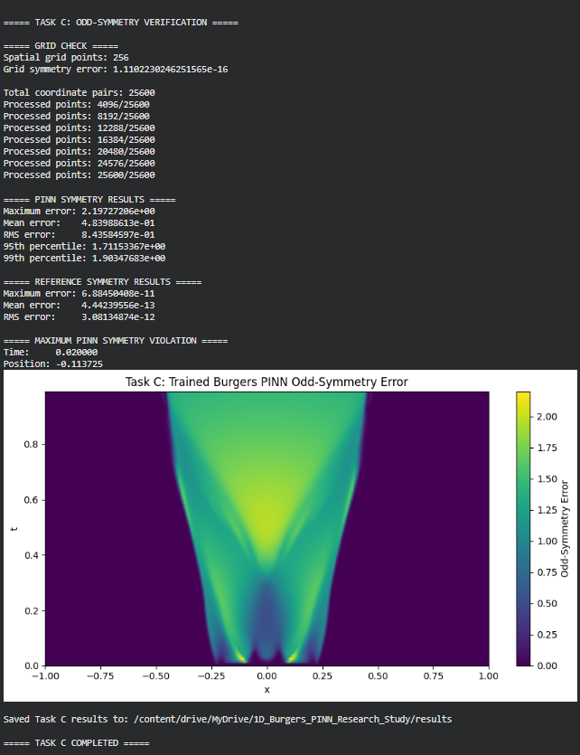

# B1.2 — Consolidated Diagnostic Verification of the Vanilla Burgers PINN

**Status:** Diagnostic verification completed for the saved Adam + L-BFGS baseline. The baseline is not yet an accurate reproduction of the reference solution. No sampling method has yet been isolated as the cause.

## 1. Purpose and scope

B1.2 evaluates the saved trained PINN without retraining. It asks three different questions:

1. **PDE residual:** how closely does the trained network satisfy the Burgers equation at evaluation points?
2. **Reference-solution error:** how closely does its predicted field match the supplied numerical reference field?
3. **Odd symmetry:** does the predicted field preserve the expected property $u(-x,t)=-u(x,t)$?

The verification work also checks the automatic-differentiation implementation against manufactured functions with known analytical derivatives.

## 2. Benchmark and trained checkpoint

The governing equation is

$$
u_t + u u_x - \nu u_{xx}=0,\qquad \nu=\frac{0.01}{\pi}.
$$

The domain and conditions are

$$
x\in[-1,1],\quad t\in[0,1],\quad
u(x,0)=-\sin(\pi x),\quad u(-1,t)=u(1,t)=0.
$$

The network receives inputs in the order $[t,x]$. The checkpoint metadata identifies a fully connected Tanh network with four hidden layers of 64 neurons, trained with 15,000 Adam steps followed by an L-BFGS phase configured with a maximum of 15,000 iterations. The training setup used 2,000 PDE collocation points, 256 initial-condition points, and 256 points on each boundary. The stored viscosity is 0.003183098861837907.

## 3. Verification of automatic differentiation and residual assembly

### 3.1 Manufactured derivative checks — Tests 1 and 2

Two functions with analytically known derivatives were differentiated using PyTorch Autograd at three test coordinate pairs $[t,x]$.

**Test 1:**

$$
g(t,x)=t^2+x^2,\quad g_t=2t,\quad g_x=2x,\quad g_{xx}=2.
$$

The computed derivatives matched the analytical derivatives (maximum errors printed as zero).

**Test 2:**

$$
g(t,x)=t^2+x^3,\quad g_t=2t,\quad g_x=3x^2,\quad g_{xx}=6x.
$$

The computed derivatives matched the analytical derivatives (maximum errors printed as zero). This second test is particularly useful for distinguishing the spatial second derivative from an accidental differentiation with respect to the time input, because $g_{xx}=6x$ varies with the spatial coordinate.

### 3.2 Manufactured Burgers residual — Test 3

For $g(t,x)=t^2+x^3$, the Burgers residual was assembled as

$$
R_g=g_t+g g_x-\nu g_{xx}.
$$

The Autograd residual was compared with the analytical expression at three points. The reported maximum absolute difference was

$$
\boxed{0.0\text{ at the displayed output precision}.}
$$

The manufactured function is not expected to solve Burgers, so its residual is not expected to be zero. The zero reported error refers to the difference between the Autograd and analytical residual calculations.

### 3.3 Full reference-grid manufactured residual and precision — Test 4

The same manufactured-function residual calculation was repeated over the reference coordinate grid:

- 256 spatial coordinates;
- 100 time coordinates;
- 25,600 $(t,x)$ pairs;
- batch size 4,096.

Reported results:

| Comparison | Maximum absolute difference |
|---|---:|
| Autograd vs analytical residual, float64 | 0 at displayed precision |
| Autograd vs analytical residual, float32 | 0 at displayed precision |
| float32 vs float64 residual | $1.0435867\times10^{-6}$ |

Mean absolute float32/float64 difference was $7.4895641\times10^{-7}$. This is a manufactured-function check; it is not evidence that float32 and float64 behave equally during PINN training.

**What these tests establish:** the tested Autograd derivative operations, coordinate-column selection, second spatial derivative, viscosity/sign convention, residual assembly, batching, and the chosen float32/float64 evaluation comparison agree with known analytical calculations for the manufactured function.

**What they do not establish:** they do not establish that the trained neural network has learned the correct Burgers solution.

## 4. Trained-model PDE residual — Task A

The saved Adam + L-BFGS checkpoint was loaded. The network's own prediction $u_\theta(t,x)$ was differentiated, and the residual

$$
R_\theta(t,x)=u_t+u_\theta u_x-\nu u_{xx}
$$

was evaluated over the 25,600 reference-grid points in batches of 4,096. The original training residual function was used for the initial Task A calculation; a self-contained evaluation version was subsequently prepared with identical residual mathematics and without retaining a higher-order graph for parameter backpropagation.

Reported Task A results:

| Statistic | Value |
|---|---:|
| Maximum $\lvert R_\theta\rvert$ | 192.89259 (approximately) |
| Mean $\lvert R_\theta\rvert$ | 0.46191284 |
| Mean signed residual | 0.35705389 |
| RMS residual | 5.0032792 |
| 50th percentile of $\lvert R\rvert$ | 0.00142931275 |
| 90th percentile of $\lvert R\rvert$ | 0.0277124941 |
| 95th percentile of $\lvert R\rvert$ | 0.269357538 |
| 99th percentile of $\lvert R\rvert$ | 8.51740588 |

The maximum residual occurred at approximately $t=0.01$, $x=0.098039$. All residual values were finite.

The residual distribution is strongly nonuniform: the median and 90th percentile are relatively small compared with the maximum and upper percentiles. The heatmap shows localized high-residual structures rather than a uniformly large residual throughout the domain.

### Interpretation and consistency with original B1.2

The original B1.2 code manually assembled the same residual from Autograd derivatives. Its reported maximum and mean absolute residuals were approximately 192.9 and 0.4619, respectively, consistent with Task A.

Task A is therefore a **consistency check between two implementations/evaluation paths**, not an independent proof that the formula is correct. The independent analytical evidence comes from the manufactured-function tests in Section 3. The trained-model residual remains a measure of how well this particular prediction satisfies the PDE, not a direct measure of reference-solution accuracy.

## 5. Reference-solution comparison — Task B

The predicted field was compared with `usol` from `Burgers.npz` at the matching 25,600 space-time coordinates. The reference data was used only for evaluation, not training.

| Metric | Task B result |
|---|---:|
| Relative $L_2$ error | 0.964119575 |
| Relative $L_\infty$ error | 2.20079525 |
| Maximum absolute error | 2.20079576 |
| RMSE | 0.592294823 |

At the final reference time $t=0.99$, the maximum-absolute-spatial-gradient locations within $[-0.8,0.8]$ were:

| Field | Estimated steepest-gradient position |
|---|---:|
| Reference | 0.003922 |
| Trained PINN | 0.450980 |
| Signed displacement (PINN − reference) | +0.447059 |

This is a discrete steepest-gradient **proxy**, not a formal shock-location measurement. The viscous Burgers solution is smooth for positive viscosity. The profile and absolute-error heatmap show a substantial displacement of the steep transition and a broad field of solution error.

## 6. Odd-symmetry verification — Task C

For this benchmark, the expected solution symmetry is

$$
u(-x,t)=-u(x,t).
$$

The symmetry error was defined as

$$
E_{\mathrm{sym}}(x,t)=|u(x,t)+u(-x,t)|.
$$

The spatial grid was first checked for mirrored coordinate pairs. Its maximum symmetry discrepancy was $1.1102230\times10^{-16}$, i.e. at floating-point precision.

**Trained PINN:**

| Statistic | Value |
|---|---:|
| Maximum symmetry error | 2.19727026 |
| Mean symmetry error | 0.483988613 |
| RMS symmetry error | 0.843854579 |
| 95th percentile | 1.71153367 |
| 99th percentile | 1.90347683 |
| Maximum-error location | $t=0.02,\;x=-0.113725$ |

**Reference solution:**

| Statistic | Value |
|---|---:|
| Maximum symmetry error | $6.8845040\times10^{-11}$ |
| Mean symmetry error | $4.44239556\times10^{-13}$ |
| RMS symmetry error | $3.08134874\times10^{-12}$ |

The reference is essentially odd-symmetric to numerical precision, while the trained PINN shows a substantial violation. This makes an asymmetric reference grid or materially asymmetric reference solution an implausible explanation for the PINN's observed symmetry error.

## 7. Consolidated findings

1. Manufactured-function derivatives and residual assembly agree with analytical calculations at the tested points and across the reference grid.
2. The trained-model residual calculation is consistent with the earlier B1.2 diagnostic to the reported precision.
3. The trained network has localized large PDE residuals despite much smaller residual magnitudes over much of the grid.
4. The network's reference-solution error is large: relative $L_2$ error is approximately 0.964.
5. At $t=0.99$, the estimated steepest-gradient position is displaced by approximately 0.447 in the positive-x direction.
6. The reference solution is essentially odd-symmetric, whereas the trained PINN is not.
7. These diagnostics establish that the current baseline is inaccurate; they do **not** establish that uniform-random sampling alone caused the failure.

## 8. Limitations and next experiment

The current verification is based on one saved checkpoint and one evaluation precision (float32 for the trained model). The manufactured-function float32/float64 test is not a comparison of trained-model training stability. The diagnostic grid is a reference grid, not a proof that residual behaviour between all possible points has been exhaustively characterized.

Before attributing the failure to sampling, the next stage will compare sampling approaches under controlled conditions: fixed architecture, optimizer schedule, initial/boundary sampling, training budget, evaluation grid, and preferably repeated random seeds. Save the actual collocation coordinates, seeds, and evaluation metrics for every run. Start with a documented uniform baseline, then compare quasi-random sequences and residual-adaptive methods such as RAD and RAR-D; include RAR-G as a method with known potential point-clustering behaviour, which is also used in Poissons Benchmark in the work. A change in sampling should not be the only uncontrolled change between comparison cases.

## References

- Raissi, M., Perdikaris, P., and Karniadakis, G. E. (2019). *Physics-informed neural networks: A deep learning framework for solving forward and inverse problems involving nonlinear partial differential equations*. Journal of Computational Physics, 378, 686–707. https://doi.org/10.1016/j.jcp.2018.10.045
- Wu, C., Zhu, M., Tan, Q., Kartha, Y., and Lu, L. (2023). *A comprehensive study of non-adaptive and residual-based adaptive sampling for physics-informed neural networks*. Computer Methods in Applied Mechanics and Engineering, 403, 115671. https://doi.org/10.1016/j.cma.2022.115671